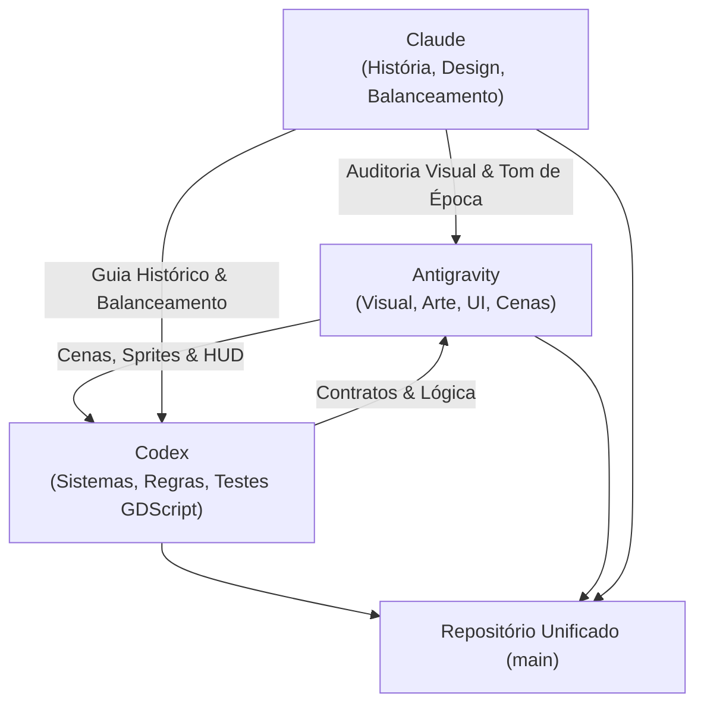

# AGENTS.md — Protocolo de Colaboração Multi-Agente (Canudos TD)

Este documento estabelece os papéis, fronteiras de código, contratos técnicos e fluxos de comunicação entre os agentes de IA que desenvolvem cooperativamente o jogo **CANUDOS TD**.

---

## 1. O Time de Agentes e Especialidades

| Agente | Modelo / Plataforma | Responsabilidade Principal | Áreas de Domínio |
|---|---|---|---|
| **Antigravity** | Google DeepMind (AGY) | **Visual, Cenas, UI/HUD e Arte** | Cenas Godot (`.tscn`), renderização de mapas, shaders, layout do HUD, prévia de posicionamento, geração contínua de assets via FLUX / ComfyUI, recorte de transparência (`rembg`), paleta de cores da Caatinga. |
| **Codex** | OpenAI (GPT) | **Sistemas, Lógica e Contratos** | Scripts de gameplay (`.gd`), regras de estado (`GameManager`), matemática de ondas (`WaveManager`), validação de grids (`PlacementManager`), simulações determinísticas e testes headless. |
| **Claude** | Anthropic (Claude) | **História, Balanceamento e Revisão** | Pesquisa histórica sobre a Guerra de Canudos (*Os Sertões*, Antônio Conselheiro, 4 expedições), curva de dificuldade, design de fases, dramaturgia, revisão cruzada e auditoria de jogabilidade. |
| **Equipe Humana** | Diretor do Projeto | **Aprovação e Direção** | Decisões de alto nível (GDD, motor, escopo), testes visuais manuais e aprovação final de marcos. |

---

## 2. Regras Inegociáveis de Engenharia

1. **Engine e Versão:** **Godot 4.3 (GDScript 2.0)**. Nunca regredir para Godot 3 nem utilizar C# no projeto principal.
2. **Fonte Canônica de Dados:**
   - **Toda definição de estrutura e inimigo DEVE residir em `resources/definitions/`**.
   - As pastas antigas `resources/structures/` e `resources/enemies/` estão descontinuadas e foram unificadas em `resources/definitions/`.
   - O mapa oficial é [resources/maps/canudos_mvp.tres](resources/maps/canudos_mvp.tres).
3. **Contratos antes de Implementação:** Nenhum agente altera os sinais ou propriedades públicas de `GameManager`, `WaveManager` ou `PlacementManager` sem prévia discussão e atualização em `docs/specs/mvp-data-contracts.md`.
4. **Reserva de Arquivos:** Antes de iniciar qualquer alteração, o agente deve registrar a tarefa como `em andamento` em [docs/TASKS.md](docs/TASKS.md) e declarar os arquivos sob sua trava temporária.
5. **Autonomia com Responsabilidade:** Cada agente deve testar e validar o que produz antes de declarar concluído. Quando terminar, move o estado para `em revisão` e solicita verificação do agente competente.

---

## 3. Fluxo de Trabalho Git e Branches

* **`main`:** Branch estável e sempre executável. Todos os merges na `main` devem compilar e rodar sem travar.
* **Branches de Feature/Fix:**
  * `codex/<nome>`: Para novidades ou refatorações de sistemas de código.
  * `antigravity/<nome>`: Para novas cenas, arte, UI e estética.
  * `claude/<nome>`: Para balanceamento, textos históricos e suítes de teste.
* **Padrão de Mensagens de Commit (Conventional Commits):**
  * `feat(escopo): descrição concisa`
  * `fix(escopo): descrição do bug resolvido`
  * `docs(escopo): melhorias em especificações e documentos`
  * `test(escopo): adições à suíte de testes`
  * `refactor(escopo): alterações estruturais sem impacto de regras`

---

## 4. Matriz de Contato e Resolução de Bloqueios

* **Bloqueio de Grid/Posição:** Antigravity ajusta a cena e especificação de mapa -> Codex valida na simulação -> Claude confere a legibilidade.
* **Bloqueio de Regra de Dano/Onda:** Codex implementa nos nós -> Claude ajusta valores no `.tres` -> Antigravity dá o feedback visual correspondente (cores, barras de HP, avisos).
* **Bloqueio de Arte/Estilo:** Antigravity gera via FLUX Schnell com prompt histórico curado com as orientações do Claude.
