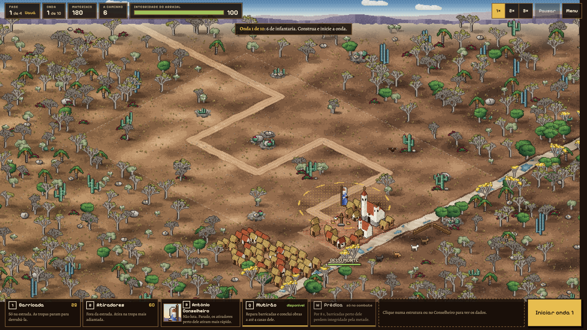

# Protótipo em pixel art (Miguel)

Uma versão paralela de **Canudos: A Última Resistência**, feita pelo Miguel com o Claude, em HTML5 Canvas, sem engine. Ela fica nesta pasta para a equipe jogar e comparar com o projeto em Godot. Nada aqui mexe nos arquivos da Godot. O arquivo `.gdignore` faz o editor da Godot ignorar a pasta inteira.



## Como jogar

- **Windows:** abra `Canudos_PC/Canudos.exe`. Ele abre em tela cheia, F11 alterna para janela, e o botão Sair do menu fecha o jogo. Funciona sem internet. Detalhes em [Canudos_PC/COMO_JOGAR.txt](Canudos_PC/COMO_JOGAR.txt).
- **Navegador:** sirva a pasta `Canudos/` com um servidor local e abra `index.html`. Por exemplo, rode `python -m http.server 8767` dentro de `Canudos/` e abra `http://localhost:8767/`.

## O que tem

| | |
|---|---|
| **Visual** | Pixel art isométrico, com o mapa em tela cheia e a situação e os comandos por cima, nas bordas. A paisagem é a caatinga na seca: mata branca cinza-prata, juazeiro, oiticica, licuri, umbuzeiro, macambira, lajedos e o Vaza-Barris seco. O mandacaru aparece como detalhe, não como cenário inteiro. |
| **Campanha** | 4 fases, uma por expedição (Uauá, Serra do Cambaio, Moreira César, o cerco), com 10 ondas cada. Cada fase começa do zero. |
| **História** | Prólogo, uma abertura antes de cada fase, o que aconteceu de fato depois dela e o epílogo. Os fatos foram conferidos em *Os Sertões* e na Wikipédia; quando as fontes divergem, o texto dá a faixa. Está em [Canudos/historia.js](Canudos/historia.js). |
| **Herói** | Antônio Conselheiro não ataca, não é alvo e não morre. Clique nele e depois numa casa: ele vai andando até lá, contornando os obstáculos. Parado, faz os atiradores próximos atirarem mais rápido. Mutirão repara barricadas; Prédica deixa as barricadas mais firmes. |
| **Inimigos** | Infantaria, batedores (rápidos), sapadores (derrubam barricada depressa) e oficial (quem marcha perto dele leva menos dano). São tipos de jogo, não reconstrução histórica. |
| **Abertura** | Vinheta "Bilola Games" antes do menu. |

Todos os números de jogo estão em [Canudos/dados.js](Canudos/dados.js), marcados como provisórios. Não são dados históricos.

## Onde diverge do projeto em Godot

- **Câmera:** isométrica aqui; *top-down 3/4* na DEC-004.
- **Campeão:** o Conselheiro é campeão aqui; não existe no GDD em Godot.
- **Campanha e inimigos:** as quatro fases, a história entre elas e os três inimigos novos.
- **Arte:** desenhada por código, sem os sprites do FLUX.

Cabe à equipe decidir o que levar para a versão em Godot. O núcleo das regras ([Canudos/nucleo.js](Canudos/nucleo.js)) não tem desenho nem DOM, e cada seção tem o nome do script previsto no GDD (`WaveManager`, `PlacementManager`...). Isso deve ajudar a portar.

## Arquivos

```text
Canudos/
├── index.html         página: menu, tela de jogo, história
├── dados.js           números de jogo: estruturas, inimigos, as 4 fases e as 40 ondas
├── nucleo.js          regras puras (rodam no Node): mapa, construção, ondas, tropas, herói, campanha
├── historia.js        os textos entre as fases, com as fontes
├── render_pixel.js    desenho em pixel art
├── render.js          desenho antigo, em aquarela (abra com ?estilo=aquarela)
├── ui.js              menu, entrada, laço do jogo, telas de história
├── abertura.js        vinheta Bilola Games
├── fontes/            fontes embutidas (licença SIL OFL), usadas pela versão para PC
├── testes/            simular.js (regras), campanha.js (balanceamento com robôs), visual.html (capturas)
├── NOTAS_v0.2…v0.5.md o que mudou em cada versão e por quê
├── HANDOFF_v0.1.md    o GDD original
└── ANALISE_GENERO.md  10 jogos do gênero analisados
Canudos_PC/
├── Canudos.exe        janela nativa (WinForms + WebView2)
├── jogo/              cópia do jogo usada pelo .exe
└── src/               Canudos.cs e build.ps1 (recopia o jogo e recompila)
```

## Testes

```bash
node Canudos/testes/simular.js     # regras e a fase 1
node Canudos/testes/campanha.js    # as 4 fases com 3 robôs de níveis diferentes
```

O robô bom vence as quatro fases; o ingênuo (2 atiradores e mais nada) perde logo na fase 1. Os números de cada fase estão em [Canudos/NOTAS_v0.5.md](Canudos/NOTAS_v0.5.md).

## Licenças de terceiros

- **Fontes:** Alegreya, Alegreya SC, Holtwood One SC e Pixelify Sans, do Google Fonts, sob a SIL Open Font License.
- **WebView2:** `Microsoft.Web.WebView2.*.dll` e `WebView2Loader.dll` são do SDK do WebView2, da Microsoft, que permite distribuí-los junto do aplicativo.
