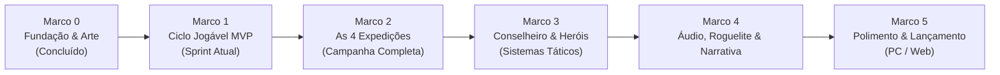

# ROADMAP.md — Planejamento Estratégico de Desenvolvimento

Este documento estabelece o roteiro de evolução do projeto **CANUDOS TD**, desde o protótipo jogável mínimo (MVP) até o jogo completo de campanha histórica.

---

## Visão Geral dos Marcos

---

## Detalhamento dos Marcos

### Marco 0: Fundação & Pipeline de Assets (CONCLUÍDO)
- [x] Confirmação da engine: **Godot 4.3 (GDScript)** (DEC-001).
- [x] Criação do repositório no GitHub: `https://github.com/Chneto/CANUDOS-TD`.
- [x] Especificação técnica do mapa v1.1 com células 64x64 e posições de barricada com `attack_stop_point`.
- [x] Estabelecimento dos contratos de dados (`mvp-data-contracts.md`).
- [x] Pipeline de geração contínua de ilustrações no FLUX.1 Schnell com recorte `rembg`.
- [x] Geração e validação dos 7 assets essenciais do MVP (sem imagens pretas, RGBA transparente).

---

### Marco 1: Ciclo Jogável do MVP (CONCLUÍDO — 100%)
**Objetivo:** Permitir que o jogador entre no mapa, posicione atiradores e barricadas, inicie a onda e veja o combate ocorrer com vitória ou derrota claras, suporte a áudio sertanejo, câmera orbital em funil, campeão Antônio Conselheiro e prévias táticas dinâmicas.

- [x] Implementação do `GameManager.gd` (fase, saúde da igreja, materiais, pontuação).
- [x] Implementação do `WaveManager.gd` (geração cadenciada de 6 soldados republicanos).
- [x] Implementação do `PlacementManager.gd` (validação de grid, custo de materiais e preview).
- [x] Implementação de `Enemy.gd` (movimentação pela `Path2D`, ataque a barricadas e dano ao objetivo).
- [x] Implementação de `DefenseStructure.gd` (busca de alvo em alcance e disparo).
- [x] Implementação de `Barricade.gd` (bloqueio físico e retenção de dano).
- [x] Criação da cena principal [scenes/map/map.tscn](scenes/map/map.tscn) com renderização de terreno e rota.
- [x] Correções da 1ª execução Godot 4.3 (T17: orientação reta do soldado, resolução de NodePaths, alcance de F1/F3).
- [x] Criação de suíte de teste headless automatizada ([tests/sim_onda.gd](tests/sim_onda.gd)).
- [x] **T15 / T18 (Antigravity):** Reorganização do layout do HUD para cartões flutuantes táticos, correção de dimensões e cortes (Conselheiro e Mutirão), prevenção de sobreposição.
- [x] **T16 (Claude):** Auditoria de jogabilidade, tom histórico e clareza das mensagens (`docs/research/audit-compreensao-tom.md`).
- [x] **T19 / T20 (Antigravity):** Cenografia avançada da Caatinga (juazeiro, lajedo, taipa) e trilha sonora sertaneja autoral (viola, pífano, zabumba).
- [x] **T21 / T23 / T24 (Antigravity & Codex):** Controle de volume contínuo (0-100%), efeitos sonoros autênticos (7 WAVs), textos de combate flutuantes e partículas.
- [x] **T22 (Codex & Antigravity):** Campeão Antônio Conselheiro no Godot 4.3 com aura de 192px, Mutirão e Prédica.
- [x] **T25 (Antigravity):** Arte de capa canônica de Belo Monte (`capa.jpg`) e compilação do executável Windows nativo `Canudos.exe`.
- [x] **T26 (Antigravity & Codex):** Câmera orbital cônica em funil (amplitude [-36°, +36°] sem inversão do mapa) e pré-visualização tática contínua com elipse de alcance de 220px e sprite fantasma translúcido sob o mouse.

---

### Marco 2: A Campanha das Quatro Expedições Históricas
**Objetivo:** Expandir de uma onda única de teste para a campanha histórica estruturada em 4 expedições com mapas e dinâmicas distintas (incorporando as lições do protótipo do Miguel):

1. **Expedição 1 — Uauá (Novembro 1896):**
   * *Comandante Inimigo:* Tenente Pires Ferreira.
   * *Cenário:* Caatinga aberta e travessia seca.
   * *Inimigos:* Infantaria básica e milícia estadual com fardamento leve.
   * *Objetivo:* Defender a passagem antes de chegar ao vale de Canudos.

2. **Expedição 2 — Serra do Cambaio (Janeiro 1897):**
   * *Comandante Inimigo:* Major Febrônio de Brito.
   * *Cenário:* Gargantas e desfiladeiros de pedra com múltiplos pontos elevados (`FIXED_SITE`).
   * *Novos Inimigos:* Batedores rápidos que tentam furar a defesa sem parar nas barricadas.
   * *Novos Defensores:* Jagunços com bacamarte de pólvora grossa (dano em área a curta distância).

3. **Expedição 3 — O Corta-Cabeças / Moreira César (Março 1897):**
   * *Comandante Inimigo:* Coronel Moreira César (7º Regimento de Cavalaria e Artilharia).
   * *Cenário:* Entrada fortificada de Belo Monte.
   * *Novos Inimigos:* Oficiais que concedem armadura e bônus de marcha às tropas próximas; canhões Krupp que bombardeiam barricadas de longe.
   * *Dinâmica:* Vitória histórica dos defensores sertanejos com saque militar de armas modernas (Mauser).

4. **Expedição 4 — O Cerco Total e a Matadeira (Junho a Outubro 1897):**
   * *Comandante Inimigo:* General Arthur Oscar / Marechal Carlos Machado Bittencourt.
   * *Cenário:* O Arraial em ruínas, trincheiras profundas e a Igreja de Bom Jesus bombardeada.
   * *Inimigos:* Sapadores com dinamite, colunas massivas do exército regular e cerco de abastecimento.
   * *Dinâmica:* Modo de resistência e sobrevivência em ondas consecutivas.

---

### Marco 3: Antônio Conselheiro e Sistemas Táticos Avançados
**Objetivo:** Introduzir o campeão sertanejo e mecânicas de liderança no mapa Godot (já prototipadas no `Miguel/Canudos/`):

- [ ] **Líder Antônio Conselheiro:** Personagem móvel no mapa que não ataca nem é alvejado. O jogador clica no Conselheiro e direciona seu deslocamento pelo Arraial.
  - *Aura de Prédica:* Aumenta a velocidade de disparo dos atiradores ao seu redor.
  - *Ação de Mutirão:* Ao se aproximar de barricadas danificadas, restaura seus pontos de vida com barro e taipa novos.
- [ ] **Heróis Auxiliares:**
  - *Pajeú:* Guerreiro de guerrilha e emboscadas noturnas.
  - *João Abade:* Estrategista militar de campo de Canudos.
- [ ] **Armadilhas de Caatinga:** Espalhar estrepes (espetos de madeira ocultos) e trincheiras ocultas na terra vermelha.

---

### Marco 4: Narrativa Histórica, Áudio e Mecânicas Roguelite
- [ ] **Dramaturgia Histórica:** Prólogos e epílogos entre as expedições baseados nos relatos de Euclides da Cunha (*Os Sertões*).
- [ ] **Áudio Imersivo:**
  - Sons de tiros secos de pólvora negra (Comblain) vs disparos metálicos de repetição (Mauser).
  - Trilha sonora atmosférica sertaneja: toques de viola caipira, rabeca e berimbau de boca.
  - Vozes e aclamações históricas ("Viva o Bom Jesus!", cornetas de infantaria).
- [ ] **Sistema de Bênçãos / Cartas de Fé:** Escolhas entre ondas que alteram a partida (ex: "Pólvora artesanal de salitre", "Água de juazeiro para os atiradores", "Trincheira reforçada").

---

### Marco 5: Polimento, UI Final e Lançamento
- [ ] Suporte a telas cheias e resoluções dinâmicas na Godot 4.3.
- [ ] Telas de Menu Principal, Seleção de Expedição, Opções de Acessibilidade e Créditos.
- [ ] Exportação estável para Windows (`.exe`), Linux e Web (`HTML5 / WebAssembly`).
