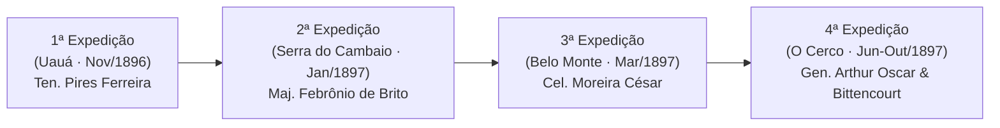

# Guia Histórico Canônico do MVP — Canudos TD

**Autor:** Claude (História, Balanceamento e Revisão)  
**Referência Principal:** *Os Sertões* (Euclides da Cunha, 1902) e fontes historiográficas contemporâneas  
**Documento do Marco 0:** Tarefa T03  
**Status:** Canônico e Vinculante para Antigravity e Codex  

---

## 1. O Cenário: O Sertão e a Caatinga (1896–1897)

Canudos não foi um conflito entre nações, mas o choque trágico entre duas realidades do Brasil do final do século XIX: o litoral republicano, positivista e burocrático, e o sertão profundo, esquecido pelo Império e abandonado pelas secas.

### 1.1 A Terra
* A **Caatinga** ("mata branca" em Tupi): vegetação caducifólia que parece morta nos meses secos (cinza-prateada), mas é densa, armada de espinhos duros e galhos retorcidos (jurema, catingueira, marmeleiro, favela, macambira).
* Pontos de verde perene: o **juazeiro** e a **oiticica**, cujas raízes profundas retêm água e servem de abrigo e sombra para os defensores.
* O **Rio Vaza-Barris**: leito pedregoso e seco na estiagem, serpenteando o vale onde se aninhava a cidadela de Belo Monte, protegido por serras escarpadas (Serra do Cambaio, Serra Vermelha, Caipá).

---

## 2. Antônio Conselheiro e a Cidadela de Belo Monte

Antônio Vicente Mendes Maciel (1830–1897), o **Conselheiro**, não era um general militar nem um líder político partidário. Era um beato leigo, peregrino errante que há duas décadas percorria os sertões de Pernambuco, Sergipe e Bahia consertando cemitérios, rebocando capelas e pregando uma vida de piedade, solidariedade comunitária e oração.

### 2.1 A Fundação de Belo Monte (1893)
* Estabelecido na antiga fazenda abandonada de Canudos, renomeada por ele como **Belo Monte**.
* Tornou-se um refúgio para dezenas de milhares de sertanejos: ex-escravizados após a abolição de 1888, vaqueiros despossuídos, indígenas remanescentes e famílias fugindo da grande seca.
* Chegou a ter cerca de 25.000 a 30.000 habitantes — a segunda maior cidade da Bahia na época, superada apenas por Salvador.
* **Economia:** Criação coletiva de cabras e galinhas, plantio de feijão, milho e mandioca nas vazantes do Vaza-Barris, e comércio de couros curtidos com Juazeiro e Monte Santo.

---

## 3. As Quatro Expedições Militares e a Campanha do Jogo

O jogo estrutura sua progressão exatamente sobre as quatro expedições enviadas para destruir o arraial:

### 3.1 Primeira Expedição (Novembro de 1896) — Fase 1: Uauá
* **Comandante:** Tenente Manuel da Silva Pires Ferreira.
* **Efetivo:** Cerca de 100 soldados e praças da Polícia da Bahia.
* **O Conflito:** As tropas acamparam na pequena povoação de Uauá esperando os conselheiristas. Ao amanhecer do dia 21 de novembro, sob a cerração, os sertanejos atacaram de surpresa armados com espingardas antigas, foices e chuços.
* **Resultado Histórico:** Grande mortandade entre os conselheiristas pelo fogo concentrado das armas de repetição, mas a tropa militar perdeu homens cruciais, entrou em pânico logístico e bateu em retirada desordenada para Juazeiro.

### 3.2 Segunda Expedição (Janeiro de 1897) — Fase 2: Serra do Cambaio
* **Comandante:** Major Febrônio de Brito.
* **Efetivo:** Mais de 500 soldados do Exército regular com peças de artilharia Krupp.
* **O Conflito:** Na garganta estreita da Serra do Cambaio, os jagunços travaram emboscadas laterais nas escarpas, aproveitando o desconhecimento militar da caatinga. Os soldados marchavam em fila indiana carregando mochilas pesadas sob sol abrasador.
* **Resultado Histórico:** As tropas foram dizimadas pela sede e pelo fogo invisível dos atiradores ocultos nos lajedos. O Major ordenou retirada humilhante, abandonando munição.

### 3.3 Terceira Expedição (Março de 1897) — Fase 3: Moreira César
* **Comandante:** Coronel Antônio Moreira César (o célebre "Corta-Cabeças" da Revolta da Armada).
* **Efetivo:** Cerca de 1.300 homens veteranos, cavalaria, canhões Krupp e médicos militares.
* **O Conflito:** Moreira César acreditava tomar o arraial em apenas duas horas. Ao penetrar nas ruelas labirínticas de taipa de Belo Monte, as tropas foram cercadas por fogo cruzado vindo de janelas, frestas de telhados e barricadas nas esquinas.
* **Resultado Histórico:** O Coronel foi mortalmente ferido no abdômen. A retirada virou debandada caótica: centenas de soldados abandonaram fuzis Mauser, canhões, cartuchos e uniformes, armando pesadamente os conselheiristas para o restante da guerra.

### 3.4 Quarta Expedição (Junho a Outubro de 1897) — Fase 4: O Cerco Final
* **Comandante:** General Arthur Oscar de Andrade Guimarães e Ministro da Guerra Carlos Machado Bittencourt.
* **Efetivo:** Mais de 8.000 a 10.000 soldados regulares, quase metade de todo o Exército Brasileiro, com fuzis modernos e a famosa peça Withworth 32 apelidada de *"A Matadeira"*.
* **O Conflito:** Cerco total cortando a água do Vaza-Barris e as linhas de abastecimento de comida. Meses de combate casa a casa, trincheira a trincheira. O Conselheiro faleceu em 22 de setembro devido à desinteria e à privação alimentar.
* **Resultado Histórico:** A queda final em 5 de outubro de 1897. Euclides da Cunha eternizou: *"Canudos não se rendeu. Exemplo único em toda a história, resistiu até ao esgotamento completo. (...) Caíra no dia 5, ao entardecer, quando caíram os seus quatro únicos defensores, que um batalhão inteiro não pôde rechaçar: um velho, dois homens feitos e uma criança, na frente dos quais rugiam raivosamente cinco mil soldados."*

---

## 4. Táticas Militares e Armamento Comparado

| Aspecto | Exército Republicano | Jagunços / Conselheiristas |
|---|---|---|
| **Doutrina** | Europeia/positivista: colunas em linha, disciplina de pelotão, marcha rígida em estrada aberta. | Guerrilha da Caatinga: dispersão, fogo cruzado, emboscada em curvas e lajedos, defesa elástica. |
| **Arma Principal** | Fuzil Mauser modelo 1894 (7×57mm) e Comblain belga (11mm), ambos com baioneta de lâmina longa. | Espingardas antigas de pederneira e espoleta (Lazarinas), garruchas, facões de arrasto e fuzis capturados. |
| **Proteção/Vestimenta** | Farda de lã/brim azul-ferrete e brim cáqui, quépis com pala, botas de couro pesado e mochilas rígidas. | Gibão e peitoral de couro cru curtido, perneiras, alpercatas e chapéu de meia-lua com orações. |
| **Artilharia** | Canhões Krupp de montanha e Withworth 32 (*A Matadeira*), lançando granadas e estilhaços. | Nenhuma de fábrica; operavam peças capturadas com munição improvisada de pregos e pedras. |

---

## 5. Matriz de Fidelidade: Fato, Licença Poética e Jogo

| Elemento | Realidade Histórica | No Canudos TD | Justificativa de Game Design |
|---|---|---|---|
| **Antônio Conselheiro como Campeão** | O líder espiritual orava, jejuava e aconselhava; não pegava em armas nem comandava pelotões de choque. | Unidade não-combatente com aura que acelera atiradores e usa *Mutirão* (reparo) e *Prédica* (fé). | **100% fiel à essência moral:** sua presença eleva a moral e a eficácia defensiva da comunidade sem trair seu voto de paz. |
| **Barricadas na Estrada** | O arraial era um emaranhado de casas de taipa e trincheiras cavadas no chão com esteios de aroeira. | Estruturas posicionadas na estrada para conter e desacelerar o avanço inimigo. | Mecânica fundamental de Tower Defense (canalização e tempo de exposição aos atiradores). |
| **Atiradores em Posições Fixas** | Piquetes de jagunços ficavam entrincheirados em pedras altas (lajedos) e casas de adobe. | Torres de defesa que disparam em arco de alcance contínuo com munição de pólvora seca. | Representação estilizada da defesa territorial sertaneja. |
| **Tipos Inimigos (Batedor, Sapador, Oficial)** | As tropas eram organizadas em batalhões regulares com praças e oficiais de infantaria e cavalaria. | Unidades com papéis táticos claros (velocidade, dano a barricadas, aura de proteção). | Diferenciação mecânica necessária para desafiar o jogador em cada fase. |

---

## 6. Diretrizes de Tom, Dramaturgia e Vocabulário

1. **Evitar Caricaturas:** Os sertanejos não devem ser retratados como "bárbaros fanáticos" (o preconceito da imprensa litorânea de 1897), mas como trabalhadores rurais, famílias e homens de fé defendendo seu teto e dignidade contra o arbítrio estatal.
2. **Respeito ao Exército:** Os soldados, em sua maioria jovens praças humildes do Nordeste e do Sul, também sofreram com a fome, a sede e a incompetência do comando. O drama é nacional e humano.
3. **Linguagem de Cordel e Crônica:** Usar métrica e vocabulário autêntico: *arraial*, *Belo Monte*, *mata branca*, *lajedo*, *gibão*, *esteio de aroeira*, *beato*, *jagunço*, *cerração*, *batalhão*.
